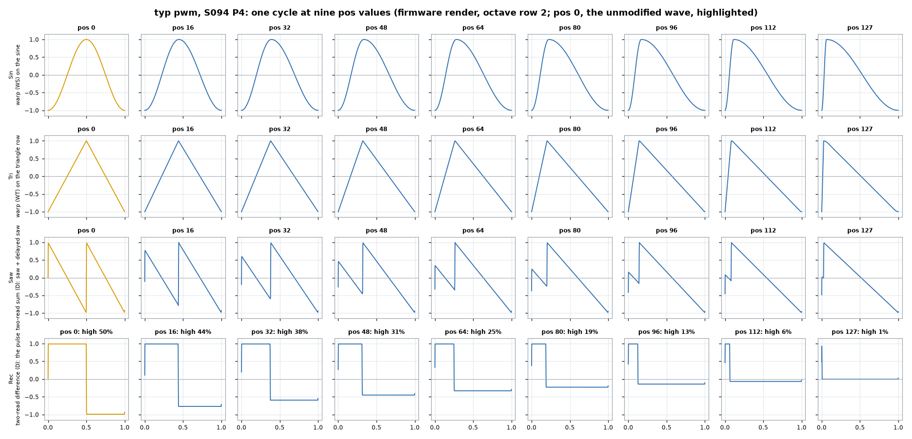
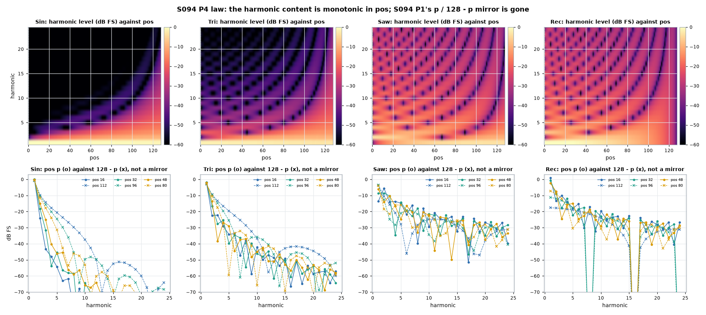
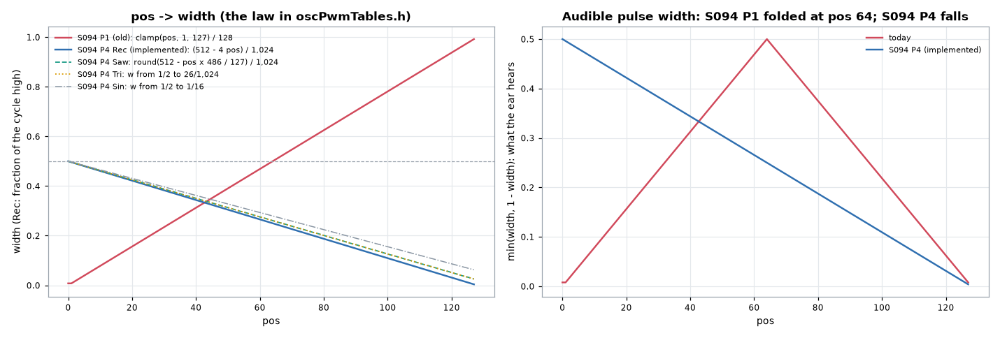
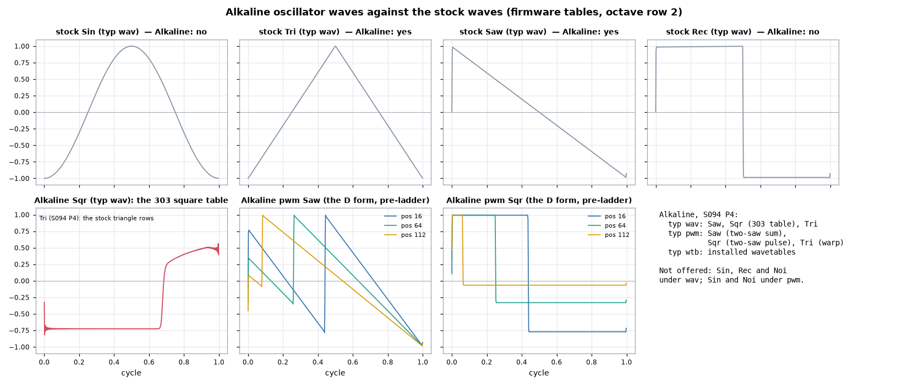

# S094 P4 — PWM Oscillator Investigation

- **Status:** **decided (user, 2026-11-11); implementation schedule in
  §9.** No firmware code is changed by this document. One host tool and
  one plot script were added to make the plots (§7).
- **Decisions (user):**
  - Alkaline `wav`: add **Tri only** (no Rec, Sin or Noi).
  - Alkaline `pwm`: add **Tri only** (user, revised). No Sin: the ladder
    filters highs so strongly that a warped sine and a warped triangle
    would sound practically the same. No Noi, since there is no pulse-width
    form of noise. Rec is the existing Sqr.
  - Every other recommendation is accepted (§6), with option A for the
    tables (all tabled).
  - The code schedule is `S094_P4_IMPLEMENTATION.md`.
- **Question (user):**
  1. Under `typ pwm` the widest-sounding setting is `pos` 64, the narrowest
     are 0 and 127, and the two ends sound almost the same. Why was this
     range chosen? The user expects `pos` 0 to be a 50 % square and 127 the
     narrowest pulse. The control does not need to wrap round.
  2. Plots of every PWM waveform at a range of positions.
  3. Can the Alkaline offer every stock waveform under both `wav` and `pwm`,
     or is there a reason to leave some out?
- **Evidence:** every plot and figure comes from the shipped firmware code,
  not from a re-implementation:
  - `osc_pwmRenderPlain()` from `Oscillator.c`, built for the host;
  - the real stock tables, extracted from `wavetable.c`;
  - the real Alkaline square table.

  One cycle is exactly 512 samples (about 86 Hz), on octave row 2, which is
  the row the firmware picks at that pitch.

---

## 0. Summary

1. **Your hearing is right, and it is by construction.**
   - Today `pos` sets the width as `pos / 128` of the cycle (clamped to
     1..127), and `pos` 64 is the unmodified wave: a 50 % square under Rec.
   - Moving away from 64 in **either** direction narrows the pulse. `pos`
     *p* and `128 − p` are the same pulse, one upside down.
   - Measured on every position, the harmonic levels of *p* and `128 − p`
     are identical: 0.00 dB for Saw and Rec, 0.02 dB for Sin, within
     0.6 dB for Tri above −40 dB.
   - So for a held note, half of the knob repeats the other half.
2. **The range was never chosen as a knob law.**
   - The PWM draft (S094 P0, decision P-D3) defined the width so that 64
     plays the stock wave unchanged, and a bipolar sweep around 64 skews
     the wave both ways.
   - The fact that both ways sound the same was not considered.
   - Your expectation (0 = 50 %, 127 = narrowest, no wrap) is the usual
     synth convention, and it uses the whole knob.
3. **Fix (decided, §4, §9):**
   - `pos` 0 = the unmodified wave (50 %), `pos` 127 = the narrowest.
   - 128 distinct widths, linear in width, from position-indexed tables.
   - The narrowest width is **0.39 % for Rec** (and the Alkaline `pwm` Sqr,
     which is the same pulse), 2.54 % for Saw and Tri, and 6.25 % for Sin
     (user).
   - No per-sample cost and no RAM. The tables cost about +3.5 KB of flash
     net (the first estimate of 1.6 KB was low; see
     `S094_P4_IMPLEMENTATION.md` §11.1).
4. **Alkaline (decided, §5, §9):** today it offers only Saw and its 303
   square, under both `wav` and `pwm`. The reason is scope (the TB-303 VCO),
   not a technical limit.
   - **`wav`** gains **Tri**: 0 per sample, in the existing fused loop.
   - **`pwm`** gains **Tri** (the warp form): one new fused ladder mode,
     gated by a spike measured against the Alkaline's dearest path. No Sin
     (user).
   - New entries are appended, so existing Kits keep their sound.

---

## 1. How `pos` becomes a width today

**Drum, Snare, Cymbal, HiHat** (`Oscillator.c`, `osc_pwmPlan()`, once per
block):

| Step | Code | Meaning |
|---|---|---|
| p | `positionApplied & 127`, then `p < 1 → 1` | `pos` 0 behaves as 1 (P-D3) |
| D forms (Saw, Rec) | `d = p << 3` points of 1,024 | the second read is `p/128` of a cycle behind: the pulse is high for `p/128` |
| W forms (Sin, Tri) | `wPh = p << 25`, `ra = recip[p]`, `rb = recip[128 − p]` | the first half-cycle of the table plays over `p/128` of the cycle, the second half over the rest |
| Level (D) | `oscPwmLevelQ14[max(p, 128 − p) − 64]` = 64 / max(p, 128 − p) | keeps the peak at full scale at every width |
| Lift (Tri) | `oscPwmLift[p]`, 0 at 64, 6 at 1 and 127, symmetric | a duller octave row as the warp squeezes one half |
| Slew | `osc_typedPositionApply()`: at most 2 steps per block (`OSC_PWM_SLEW_STEPS`) | 64 steps in about 23 ms |

**Alkaline** (`AlkalineVoice.c`, `alk_renderPwm()`): the same `p`, the
same `d = p << 3` and the same level, into `DiodeLadder_renderB2OscPwm()`.

Every quantity is symmetric about 64: `d` and `1024 − d`, `ra` and `rb`
swapped, the level and the lift indexed by distance from 64.

---

## 2. What it plays (measured, the shipped render)

### 2.1 One cycle at nine positions



`tools/plots/s094p4_pwm_shapes.png`: one cycle per wave at `pos` 0, 16,
32, 48, 64, 80, 96, 112, 127. `pos` 64 is highlighted.

| Wave | Form | `pos` 0 | `pos` 64 | `pos` 127 |
|---|---|---|---|---|
| Sin | warp on the sine | a ramp up with a near-vertical rise at the start | the sine | a ramp up with a near-vertical fall at the end: the mirror |
| Tri | warp on the triangle row | a falling ramp, rounded by the lifted (duller) row | the triangle | a rising ramp, rounded: the mirror |
| Saw | two saws summed | a saw | a saw an octave up | a saw |
| Rec | two saws differenced | a pulse high 1 % of the cycle | a square, high 50 % | a pulse **low** 1 % of the cycle: the same pulse upside down |

**Other observations:**
- **The pulse is AC-coupled, like an analog pulse after its coupling
  capacitor.** One level is at full scale and the other sits near zero:
  `pos` 16 is +1 / −0.13. A narrow pulse is a spike over a small offset.
- **The narrow pulse is much quieter.** The level law keeps the peak, not
  the loudness. Rec RMS: 0.989 at 64, 0.571 at 32 (−4.8 dB), 0.373 at 16
  (−8.5 dB), 0.081 at 1 (−21.7 dB). An analog pulse also loses level as it
  narrows; −21.7 dB at the narrowest is a lot.
- **The Sin warp has no octave rows** (the sine is one table). At the
  extremes one half-cycle is squeezed into 1/128 of the period: 4 samples
  at 86 Hz, under 1 sample above about 350 Hz. The steep edge then aliases.
  The Tri warp lifts to duller rows instead (the rounding in the plot).
- **`pos` 0 and `pos` 1 render identically,** sample for sample (the
  clamp).

### 2.2 Harmonic content against `pos`: the mirror



`tools/plots/s094p4_pwm_harmonics.png`:
- top row: the level of harmonics 1-24 at every `pos` 0..127, which is
  mirror-symmetric about 64;
- bottom row: `pos` *p* (o) against `128 − p` (x) for p = 16, 32, 48. The
  points lie on each other.

| Wave | Largest difference between *p* and 128 − *p*, over p = 1..63 |
|---|---|
| Sin | 0.02 dB (harmonics above −60 dB) |
| Tri | 0.63 dB above −40 dB; 3.4 dB only on harmonics between −60 and −40 dB (interpolation rounding) |
| Saw | 0.00 dB |
| Rec | 0.00 dB |

**Why they must match:**
- **Rec:** a pulse of width *w* and one of width 1 − *w* are the same
  pulse, negated and shifted. Negation and time shift leave every
  harmonic's level unchanged.
- **Saw:** `s(φ) + s(φ − w)` at 1 − *w* equals the *w* version shifted
  by *w*.
- **Sin and Tri:** the warp at 128 − *p* is the warp at *p* played
  backwards, which also leaves every harmonic's level unchanged.

So the two ends of the knob can only differ in how the waveform starts at
a trigger. In a held or repeated note they sound the same.

---

## 3. Why this range was chosen

From `S094_P0_PWM_IMPLEMENTATION.md` (§1.1, §1.2, §8) and
`S094_P1_VOICE_DSP_ADJUSTMENTS.md` (the decisions):
- **The warp was defined first.** "The cycle is split at the width point
  W = p · 2^25 ... p 64 is the unwarped wave." The natural parameter of a
  split point is its position in the cycle, 0..1, with ½ as the stock wave.
- **The pulse was written to match:** "narrow high → square → narrow low"
  (§1.2), and the D read direction was chosen so that 64 gives "exactly the
  Rec orientation" (plan finding 2).
- **P-D3** recorded only the clamp: "p = clamp(pos, 1, 127); pos 0 behaves
  as 1". It was accepted with the other recommendations.
- **What was never examined:** that *p* and 128 − *p* sound the same,
  and what the knob should feel like. The design is coherent for an LFO
  swinging both ways around 64. As a knob, half of it is wasted.

**Nothing else depends on the centre being 64:**
- the loops take whatever `d`, `wPh`, `ra`, `rb` and gain the block plan
  gives them;
- every constant is chosen per block from tables indexed by `p`.

Changing the law is a per-block change only.

---

## 4. Proposed law: `pos` 0 = 50 %, `pos` 127 = narrowest



`tools/plots/s094p4_pwm_law.png`:
- left: the width against `pos`, today against proposed;
- right: the width the ear hears (the narrower side). Today it folds at
  64; the proposal falls steadily.

**Meaning under the proposal:**

| Wave | `pos` 0 | `pos` 127 |
|---|---|---|
| Rec | square, 50 % | the narrowest pulse |
| Saw | the octave-up two-saw | ≈ a single saw |
| Sin | the sine | the most skewed sine (one direction only, which is all that is audible) |
| Tri | the triangle | the most skewed ramp |

**Two ways to build it:**

| | A: remap `p` | B: tables indexed by `pos` (**recommended**) |
|---|---|---|
| What | `p = 64 − round(pos × 63 / 127)` in `osc_pwmPlan()` and `alk_renderPwm()` | the generator (`tools/plots/gen_pwm_tables.py`) computes, for each `pos` 0..127, a width *w*(pos) on a chosen curve. It writes `d[pos]` (uint16, points of 1,024), `ra[pos]` and `rb[pos]` (uint32: ⌊(2^32 − 1) / (128 *w*)⌋ and the same for 1 − *w*), `level[pos]` (Q14) and `lift[pos]`. `osc_pwmPlan()` and `alk_renderPwm()` index them by `pos` |
| Distinct widths | 64: every width repeats over two knob steps (the stairs in the plot) | 128, on any curve, e.g. finer steps towards the narrow end, where the ear notices more |
| Per-sample cost | 0 | 0: the loops are unchanged. `ra`/`rb` need not come from a whole *p*, because the warp is `ph × 64 / (128 w)` for any *w* |
| Per-block cost | unchanged | unchanged (table loads) |
| Flash | 0 | about +0.9 KB as first estimated (two 512 B reciprocal tables in place of one, 256 B `d`, the level table 64 → 128 entries). With the decided per-form limits (§4: separate Rec/Saw *d* and level tables, separate Sin reciprocals), about +1.6 KB |
| RAM | 0 | 0 |
| Tests to update | the PW laws and AL-PW: their reference widths | the same, plus the generator's own checks (T1-T4 in `gen_pwm_tables.py`) |

**Decided (user, 2026-11-11): B, linear in width, with these limits.**

| Form | `pos` 0 | `pos` 127 | Step | Notes |
|---|---|---|---|---|
| D difference (Rec; Alkaline `pwm` Sqr) | 50 % (*d* = 512 points) | **0.39 %** (*d* = 4 points; user) | *d* = 512 − 4 × pos: exactly 4 points per step, all 128 distinct | *d* must be whole points (both reads share one fraction) |
| D sum (Saw) | 50 % (*d* = 512 points) | **2.54 %** (*d* = 26 points) | *d* = round(512 − pos × 486 / 127): 3.8 points per step, all 128 distinct | as above |
| WT (Tri) | 50 % | **2.54 %** | the same *w* | lift = round(log2(0.5 / min(*w*, 1 − *w*))): 4 at the narrow end (today 6) |
| WS (Sin) | 50 % | **6.25 %** | linear from 0.5 to 0.0625 | the sine has no octave rows; 6.25 % keeps the squeezed half-cycle at 8× the fundamental |

- **Linear in width, not a curve:** *d* is in whole 1/1,024 points, so a
  curve with finer steps at the narrow end would give repeated widths
  there. Linear gives 128 distinct D widths. A curve can come later, with
  a step floor of one point.
- **The narrowest pulse** (Rec at 0.39 %) is −24.1 dB against the square,
  by the `√(w / (1 − w))` law. It is 2 samples wide at 86 Hz. It stays
  band-limited at every pitch, because each read is a band-limited saw; at
  high notes it becomes a quiet blip rather than an aliasing edge.

**What was considered before deciding:**
- **The narrowest width.**
  - Today it is 1/128 (0.8 %): −21.7 dB against the square, and 4 samples
    wide at 86 Hz.
  - A floor of about 2-3 % keeps the narrowest pulse useful: about −15 to
    −17 dB. That is the RMS of an AC-coupled pulse with its peak held,
    √(w / (1 − w)) against the square's 1, which predicts −21.0 dB at 1/128
    against the −21.7 dB measured.
  - With B, the floor is just the curve's end point.
- **Stored Kits:** every stored `pos` under `typ pwm` changes meaning. What
  was a square (64) becomes about a 25 % pulse, and 0 becomes the square.
  Under the standing rule there is no migration; Kits made with `pwm` need
  re-setting by ear.
- **The Sin warp's edge** at the narrow end aliases above a few hundred
  Hz, because there are no sine rows to lift to. Option: end the Sin curve
  at a wider limit than Rec's. With B, each form can have its own curve if
  wanted.

---

## 5. The Alkaline and the stock waves

**Today:**

| `typ` | `wav` list | Source |
|---|---|---|
| `wav` | Saw, Sqr | `sawTable` rows; `alkSqrTable` (the 303 square: tilted, not the stock Rec) |
| `pwm` | Saw, Sqr | the D form on `sawTable` rows: the two-saw sum and the pulse |
| `wtb` | installed wavetables | the catalogue |



`tools/plots/s094p4_alk_waves.png`: the four stock waves; the Alkaline 303
square; the Alkaline pwm Saw and Sqr (pre-ladder, at `pos` 16 / 64 / 112).

**Why Sin, Tri, Rec and Noi are not offered:**
- **Scope, not a hard limit.** The Alkaline models the TB-303 voice (S092
  P0), whose VCO has only a saw and a square. S093 kept those two.
- **The fusion (S093 P3).** The oscillator's table read is fused into the
  ladder loop (−9 per sample). That loop reads one `[1024]` octave row of
  the `[11][1024]` table format.
- **PWM followed the same scope** (PWM draft §5: "Sqr becomes the variable
  pulse, Saw the two-saw sum"). The ladder got only the two-read (D) form,
  not the warp (W).

**What each addition takes:**

| Wave | Under `wav` | Under `pwm` |
|---|---|---|
| **Rec** (flat square) | `recTable` row in the same fused loop: **0 per sample**, one scale constant | already there in effect: pwm Sqr *is* the band-limited flat pulse (at 64 today, at 0 under §4). A separate "Rec" would duplicate it |
| **Tri** | `triTable` row in the same fused loop: **0 per sample**, one scale constant | the W form (warp) inside the ladder: a new fused mode (`dl_renderB2Body()` mode 4, a ladder copy of about 1.4 KB flash), reading the triangle row with the lift |
| **Sin** | a 1,024-point sine row: **2 KB flash**, then 0 per sample. The stock sine is one 4,096-point table the fused loop cannot read, and `triTable[10]` is not a pure sine (third harmonic at −39.5 dB, measured) | the same new warp mode, reading that sine row |
| **Noi** | not a table: the noise render plus the unfused ladder (the `ALK_FUSED_OSC 0` form, +9 per sample for the lost fusion, plus the noise loop); to be measured | not offered (the drum instruments do not offer it under `pwm` either) |

**Common work for any addition:**
- **The input scale per wave.** Each wave enters the ladder in volts; the
  drive and the overdrive react to level. Each new wave needs a measured
  scale, as `ALK_PWM_SQR_SCALE_V` (×1.40) was set for the pulse.
- **The `wav` list.** `alkWaveNames` (`MenuText.h`), `ALK_WAVE_*`
  (`AlkalineVoice.h`), the count assert (`menu.c`), and
  `Alkaline_setOscType()`'s list sizes.
  - **Order:** today 0 = Saw, 1 = Sqr is stored in Kits. Appending (Sin,
    Tri, Rec, Noi as 2..5) keeps existing Kits unchanged. Re-ordering to
    the stock order (Sin Tri Saw Rec) changes every stored Alkaline wave.
  - The standing rule allows either, with no migration.

**Decided (user, 2026-11-11):**

| `typ` | Today | After |
|---|---|---|
| `wav` | Saw 0, Sqr 1 | Saw 0, Sqr 1, **Tri 2** |
| `pwm` | Saw 0, Sqr 1 | Saw 0, Sqr 1, **Tri 2** |

- **Not added:**
  - Rec, Sin and Noi under `wav` (user);
  - Sin under `pwm` (user, revised: practically the same as Tri through the
    ladder);
  - Noi under `pwm` (no pulse-width form exists);
  - a separate Rec under `pwm` (it is Sqr).
- **The order** keeps today's stored values (P4-7: append). Both lists are
  Saw, Sqr, Tri, so a type switch keeps the value.
- **The scale into the ladder:** Tri's RMS equals the saw's (1/√3 of
  peak), so it starts at the saw's scale (`ALK_SAW_SCALE_V` × 1.0),
  confirmed by the same measurement as `ALK_PWM_SQR_SCALE_V`.

**The budget (S094 P2 §21):**
- The Alkaline's Basic share (19,620) is set by its **dearest** path,
  `wtb` with a slot.
- Additions under `wav` add nothing per sample and stay below it.
- A warp mode under `pwm` must be measured as no dearer than the `wtb`
  slot path. The D form today is well below it (215 against 234
  instructions per sample).

---

## 6. Decisions (user, 2026-11-11)

| # | Question | Decision |
|---|---|---|
| P4-1 | The `pos` law under `typ pwm` (drum instruments and Alkaline) | **B (accepted):** `pos` 0 = the unmodified wave (50 %), 127 = the narrowest; 128 distinct widths from `pos`-indexed tables, linear in width (§4) |
| P4-2 | The narrowest width | **Rec 0.39 % (user)**, which also applies to the Alkaline `pwm` Sqr (the same pulse); **accepted** for the others: Saw 2.54 %, Tri 2.54 %, Sin 6.25 % |
| P4-3 | Alkaline `wav`: add Tri and Rec | **Tri only (user)** |
| P4-4 | Alkaline `wav`: add Sin | **No (user)** |
| P4-5 | Alkaline `pwm`: add Sin and Tri | **Tri only (user, revised),** after the measured spike; no Sin |
| P4-6 | Alkaline Noi | **No (user)** under `wav`; none exists under `pwm` |
| P4-7 | The Alkaline wave order | **Append (accepted):** `wav` and `pwm` both Saw, Sqr, Tri |

---

## 7. Files added for this investigation (host only)

- **`tools/dsp_test/modules/pwm_dump.c`:** renders `osc_pwmRenderPlain()`
  (the firmware's `Oscillator.c`, host build) for Sin/Tri/Saw/Rec at every
  `pos` 0..127, and dumps the stock rows and the Alkaline square row.
- **`tools/dsp_test/Makefile`, target `pwm_dump`** (not in `all`): extracts
  the four stock tables from `wavetable.c` (const removed) and the
  Alkaline square table, builds and runs the dump, and writes
  `build/pwm_dump.csv`.
- **`tools/plots/plot_s094p4_pwm.py`:** reads the CSV, writes the four
  PNGs, and prints the figures quoted here.

To reproduce:
```
make -C tools/dsp_test pwm_dump
cd tools/plots && python3 plot_s094p4_pwm.py
```

**Outputs:**
- `tools/plots/s094p4_pwm_shapes.png`;
- `s094p4_pwm_harmonics.png`;
- `s094p4_alk_waves.png`;
- `s094p4_pwm_law.png`.

---

## 8. Statements this would make out of date (for the user to log, if adopted)

- **`S094_P0_PWM_IMPLEMENTATION.md`:** §1.1-1.2 (`p` 64 as the centre;
  "narrow high → square → narrow low") and P-D3.
- **`S094_P1_VOICE_DSP_ADJUSTMENTS.md` and `S094_P1_IMPLEMENTATION.md`:**
  - the PWM law;
  - the PW laws' reference widths;
  - AL-PW.
- **`INSTRUMENTS_DSP_REFERENCE.md`:**
  - the `pwm` type's `pos` meaning;
  - the Alkaline wave list, if P4-3..P4-6 are taken.
- **`tools/plots/README.md`:** a row for `plot_s094p4_pwm.py`.
- **`MEMORY.md`:** the Alkaline wave list and `pwm` `pos` meaning, if
  recorded there.
- **`AlkalineVoice.h` / `MenuText.h` comments:** the Alkaline wave lists
  (Saw/Sqr) and the `ALK_WAVE_SQUARE + 1` list sizes.

---

## 9. Implementation schedule

Superseded by **`S094_P4_IMPLEMENTATION.md`**, the full code schedule:
- S1-S3: the law for every instrument (option A: every value tabled);
- S4: the gate for the Alkaline `pwm` Tri spike;
- S5-S9: the Alkaline `wav` and `pwm` Tri;
- S10: build and record.

**Flash, estimated** (that document §11.1):
- the tables, +3,456 B net;
- one ladder copy, about +1.4 KB;
- the per-block code, about +0.3 KB.

That is about +5.2 KB in all, and no RAM.
